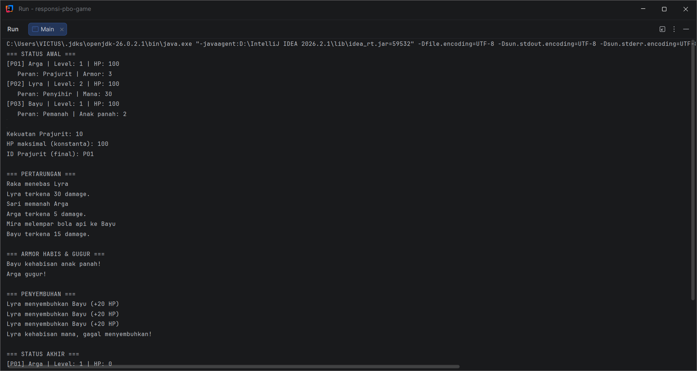
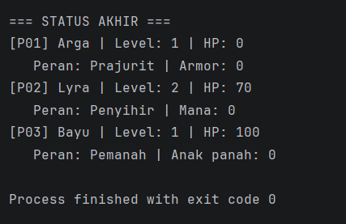

# Responsi Akhir Praktikum PBO - Sistem Game

## 1. Identitas Mahasiswa

| Keterangan | Isi |
|---|---|
| Nama | Jaris Balakosa |
| NIM | H1D025131 |
| Jurusan | Informatika, Fakultas Teknik, Universitas Jenderal Soedirman |
| Digit terakhir NIM | 1 |
| Tema | **Game** (digit 0 dan 1) |

## 2. Deskripsi Singkat

Sistem game sederhana berisi karakter yang bisa bertarung dan menyembuhkan.

- `Karakter` : superclass **abstract** (atribut: id, nama, hp, level)
- `Prajurit`, `Penyihir`, `Pemanah` : subclass dari `Karakter`
- `Penyerang` : interface untuk karakter yang bisa menyerang
- `Penyembuh` : interface untuk karakter yang bisa menyembuhkan
- `Main` : class untuk menguji semua fitur

## 3. Pemetaan 10 Persyaratan Teknis

| No | Konsep | Letak di Kode |
|---|---|---|
| 1 | State dan Behavior | Atribut `nama`, `hp`, `level`; method void `tampilkanStatus()`; method fungsi `hitungKekuatan()` di `Karakter` |
| 2 | Immutability | `public static final int HP_MAKSIMAL` dan `private final String id` di `Karakter` |
| 3 | Enkapsulasi dan Overloading | Semua atribut `private` + getter/setter, `this`, dua konstruktor di setiap class |
| 4 | Inheritance | `Prajurit`, `Penyihir`, `Pemanah` extends `Karakter`; `Main` terpisah |
| 5 | Super Chaining | `super(id, nama)` di konstruktor subclass, `super.tampilkanStatus()` |
| 6 | Method Overriding | `@Override` pada `tampilkanStatus()`, `terimaSerangan()`, `serang()` |
| 7 | Abstract Class | `abstract class Karakter` dengan `abstract void terimaSerangan(int)` |
| 8 | Logika State Percabangan | `terimaSerangan()` memakai if/else untuk membaca dan mengubah `hp` dan `armor` |
| 9 | Polimorfisme Interface | `Penyerang p1 = new Prajurit(...)` di `Main` |
| 10 | Multiple Interface | `Penyihir implements Penyerang, Penyembuh` |

## 4. Cara Compile dan Run (Terminal)

Pastikan JDK sudah terpasang (`javac -version`). Buka terminal di folder proyek, lalu:

```bash
# compile semua file
javac *.java

# jalankan program
java Main
```

## 5. Luaran Program





Teks luaran:

```
=== STATUS AWAL ===
[P01] Arga | Level: 1 | HP: 100
   Peran: Prajurit | Armor: 3
[P02] Lyra | Level: 2 | HP: 100
   Peran: Penyihir | Mana: 30
[P03] Bayu | Level: 1 | HP: 100
   Peran: Pemanah | Anak panah: 2

Kekuatan Prajurit: 10
HP maksimal (konstanta): 100
ID Prajurit (final): P01

=== PERTARUNGAN ===
Raka menebas Lyra
Lyra terkena 30 damage.
Sari memanah Arga
Arga terkena 5 damage.
Mira melempar bola api ke Bayu
Bayu terkena 15 damage.

=== ARMOR HABIS & GUGUR ===
Bayu kehabisan anak panah!
Arga gugur!

=== PENYEMBUHAN ===
Lyra menyembuhkan Bayu (+20 HP)
Lyra menyembuhkan Bayu (+20 HP)
Lyra menyembuhkan Bayu (+20 HP)
Lyra kehabisan mana, gagal menyembuhkan!

=== STATUS AKHIR ===
[P01] Arga | Level: 1 | HP: 0
   Peran: Prajurit | Armor: 0
[P02] Lyra | Level: 2 | HP: 70
   Peran: Penyihir | Mana: 0
[P03] Bayu | Level: 1 | HP: 100
   Peran: Pemanah | Anak panah: 0
```
